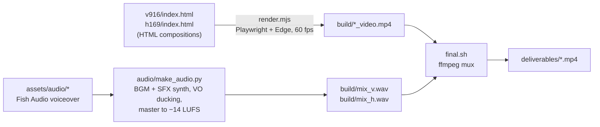

# FlightDeals Ad Studio

**Motion-graphics ads for FlightDeals.in (9:16 + 16:9), built in code.**

AI-assisted brand demo videos for FlightDeals.in, created using Claude Opus 5.5 with motion graphics and visual storytelling to showcase the travel booking platform.

Two short video ads for [FlightDeals.in](https://flightdeals.in) promoting its **Visa checker, travel eSIMs and Hotels**. Each ad tells a different story with the same goal. Everything is built in code: HTML/CSS/JS compositions are rendered frame by frame to video, and the music and sound effects are synthesized from scratch.

## Deliverables

| File | Format | Length | Story | Voice |
|---|---|---|---|---|
| `deliverables/FlightDeals_9x16_Reels.mp4` | 1080×1920, 60 fps, H.264 + AAC, −14 LUFS | 18.5 s | "3 things you forget before flying abroad": 01 Visa, 02 eSIM, 03 Hotels, then "All sorted." | Mark (Fish Audio) |
| `deliverables/FlightDeals_16x9_YouTube.mp4` | 1920×1080, 60 fps, H.264 + AAC, −14 LUFS | 25.5 s | "Ten tabs → one tab": browser chaos collapses into one tab, then a cursor tour of Visa, eSIM and Hotels, ending on "Compare. Discover. Save." | Slax (Fish Audio) |

Both files work as-is for Instagram/Facebook Reels, YouTube Shorts, YouTube in-stream and the Meta feed. The full creative brief, research notes, scripts and claims check are in [`FlightDeals_Ad_Brief.md`](FlightDeals_Ad_Brief.md).

> The final MP4s are stored with **Git LFS** because each is about 50 MB. See [`GIT_FIRST_COMMIT.md`](GIT_FIRST_COMMIT.md).

## How it works



- **Deterministic animation.** Each composition exposes `window.seek(t)`, and every element's position, scale, blur and opacity is a pure function of time. The engine provides closed-form springs, easing curves and keyframes. The renderer seeks each frame, takes a screenshot and pipes it to ffmpeg, so a frame always renders the same way.
- **Motion language.** Camera zooms in and out with blur that follows speed. Numerals zoom through the lens into the next scene. Screen-recording-style zooms follow each cursor click, and the wordmark punches in with a zoom smear. Text slams land on the beat.
- **Audio.** The original dark-build → hard-drop music runs at 140 BPM for the 9:16 (phonk cowbell) and 130 BPM for the 16:9 (trap arpeggio). The SFX are all synthesized in `audio/synth.py` and placed on visual events. The voice is cut into phrases, placed on the beat grid, EQ'd and compressed, and the music ducks under it.

## Project structure

```
.
├── README.md                  ← you are here
├── GIT_FIRST_COMMIT.md        ← step-by-step: first commit + push to GitHub
├── FlightDeals_Ad_Brief.md    ← research, business logic, scripts, claims check
├── package.json               ← Node dependency (playwright-core) + npm scripts
├── render.mjs                 ← frame-accurate renderer (seek → screenshot → ffmpeg)
├── render_par.sh              ← optional parallel renderer (needs ~16 GB RAM)
├── final.sh                   ← renders both ads, muxes audio, copies to deliverables/
├── sheet.py                   ← contact sheet of rendered stills (QA)
├── common/
│   ├── engine.js              ← motion engine: easing, springs, keyframes, starfield, grain
│   └── ui.js                  ← SVG icons, flags, QR generator
├── v916/index.html            ← 9:16 composition (scenes, timings, captions)
├── h169/index.html            ← 16:9 composition (browser UI, cursor path, scenes)
├── audio/
│   ├── synth.py               ← instruments (808, kick, clap, hats, cowbell, pads) + all SFX
│   ├── make_audio.py          ← composes BGM, places VO + SFX, mixes and masters (v | h)
│   ├── viz.py                 ← stem loudness + spectrogram plot (QA)
│   └── glitchscan.py          ← scans a video for single-frame render glitches (QA)
├── assets/
│   ├── fonts/                 ← Space Grotesk + Manrope (site fonts, OFL), local.css
│   ├── img/                   ← logo (+ transparent cut-out), destination photos
│   └── audio/                 ← voiceovers (vo_v.mp3, vo_h.mp3, vo_h_fixed.wav), fix takes
└── deliverables/              ← final ads (Git LFS)
```

Not in Git (rebuilt by the scripts): `node_modules/`, `build/` (renders, mixes, stems, logs) and `_stills/`.

## Requirements

- **Node.js 18+**, then run `npm install` (installs `playwright-core`; no browser download needed)
- **Microsoft Edge** (`render.mjs` uses `channel: 'msedge'`; change it to `'chrome'` to use Google Chrome)
- **ffmpeg** on your PATH
- **Python 3.10+** with `numpy scipy soundfile librosa pillow`
- **Git Bash** to run the `.sh` scripts on Windows

```bash
npm install
```

```bash
pip install numpy scipy soundfile librosa pillow
```

## Rebuild the ads

1. Build both soundtracks. This writes `build/mix_v.wav` and `build/mix_h.wav`:
   ```bash
   npm run audio
   ```
2. Render both videos, mux the audio and copy the results to `deliverables/`. This takes about 15 minutes on an 8 GB laptop:
   ```bash
   npm run render
   ```
3. Optional QA: preview stills, or scan a finished file for single-frame glitches:
   ```bash
   node render.mjs v916/index.html build/stills --w 1080 --h 1920 --stills 1.0,3.5,8.6,15.6
   ```
   ```bash
   python audio/glitchscan.py deliverables/FlightDeals_9x16_Reels.mp4 108 192
   ```

## Editing tips

- **Timings** live at the top of each composition's `<script>` (beat length `B`, drop `D`, scene starts) and inside each `sceneX()` function. Captions are in `CAPS` (16:9) or `words()` calls (9:16).
- **Voice placement** is the `vo_track(...)` list in `audio/make_audio.py`: `(source in, source out, timeline start)` per phrase. **SFX cues** are the `X += [...]` lists in the same file. Keep them in sync with visual events.
- **Brand colours**: navy `#0C1E45`, teal `#239587` / `#2EC4B0`, sky `#0EA5E9`, gold `#FFC21A`, coral `#F4775E`. Fonts: Space Grotesk (display) and Manrope (body).
- **Prices and claims** (₹50 eSIMs, 901 plans / 175 destinations, the Bali −55% deal) were taken from the live site on 15 Oct 2026. Refresh them before re-running the ads for a long period. The visa data is indicative, and the ad says so.

## Known gotchas

- Big gradient text (`background-clip:text`) can render half-drawn in headless capture, so the 01/02/03 numerals are pre-rendered into canvases (`bakeNumeral`). The camera's blur filter is always present (never toggled on and off) for the same reason.
- Screenshots are JPEG (fast), so `render.mjs` converts full-range to broadcast-range BT.709 during encoding. Keep that ffmpeg `-vf` line.
- Parallel rendering (`render_par.sh`) ran out of memory on an 8 GB machine. Use `final.sh`, which renders sequentially, there.

## Credits & licensing

- **Brand, logo, product UI and site photos** belong to FlightDeals.in. Destination photos are from Unsplash and Pexels, as used on the site.
- **Fonts**: Space Grotesk and Manrope (SIL Open Font License).
- **Voiceover**: Fish Audio TTS with the voices "Mark" (9:16) and "Slax" (16:9). "sim shops" in the 16:9 was regenerated and spliced in (`assets/audio/vo_h_fixed.wav`).
- **Music and SFX**: original, synthesized in this repo, so they are royalty-free for these ads.
- No open-source license is included, so all rights are reserved by default.
